<a href="https://oscar-chw.github.io"><b>Hover the interactive version</b></a> &nbsp;·&nbsp; <code>roofline</code> BTC/USDT monthly close &nbsp;·&nbsp; <code>windows</code> green up days, red down days &nbsp;·&nbsp; <code>beams</code> a <a href="https://github.com/oscar-chw/qts-platform-showcase">synthetic concurrency fixture</a>: 12 readers, 5 writers &nbsp;·&nbsp; <code>t = now</code> nothing to its right is used (<a href="https://github.com/oscar-chw/agentic-quant-research/tree/main/platform">the research platform</a>) &nbsp;·&nbsp; <code>water</code> a BTC/USDT order book refreshed daily, green bids and red asks (<a href="https://github.com/oscar-chw/agentic-quant-research/tree/main/platform/packages/imc-sim">Market-Making Lab</a>)

# Oscar Choi

Computer Science at CUHK, with minors in Data Analytics and Informatics, and Business (graduating July 2027). I build quant research infrastructure and test trading ideas against point-in-time data, with explicit controls and costs. I am the **Lead Developer & Quantitative Researcher** for the CUHK Quant Trading Society research team and the sole developer and architect of its data platform; my WorldQuant BRAIN consultant status is documented in a historical account snapshot.

<b>How this page is drawn</b>

- **The harbour** is built from data: one building per month of BTC/USDT (Binance daily closes, 2020 to now). The roof is the monthly close on a log scale, the white light is the monthly high, and each window is one trading day: green up, red down. Past "now" the towers are unlit blueprints, because nothing from the future is used. Packets on the beams replay the data platform's race test: 12 readers and 5 writers (4 appending, 1 rewriting a partition), with no commit lost. The water holds a Binance BTC/USDT order book, redrawn daily by a scheduled workflow: green bids, red asks. It all moves in plain SVG and CSS, since GitHub runs no scripts.
- **The portrait** is one continuous line through the edges of my photo, rewritten as a Fourier series, z(t) = Σ ck e2πikt: 500 circles, each turning at its own frequency, and the pen at the end of the chain redraws the face.

## Results

- **Open-source contributor to FatQat**: merged fix sizing process shot workers by the CPU affinity mask ([spaceqat/fatqat#52](https://github.com/spaceqat/fatqat/pull/52)).
- **IMC Prosperity 4** (team SHDC): 904th globally, 18th in Hong Kong.
- **Kaggle Pokémon TCG AI Battle**: team entry, 2,043rd of 6,807 teams on the Simulation leaderboard (read 2026-09-13).
- **MonsoonSIM Enterprise Resource Management Competition 2025**: 3rd place (second runner-up).

## Start with the engineering

- **Market data and replay:** [QTS architecture and trade-offs](https://oscar-chw.github.io/projects/qts-research-platform/), the [independent synthetic minilake](https://github.com/oscar-chw/qts-platform-demo), and [AQR's measured replay component](https://github.com/oscar-chw/agentic-quant-research/tree/main/platform/packages/marketdata/native).
- **GPU numerical computing:** [FatQat's CPU/GPU design](https://oscar-chw.github.io/projects/fatqat-gpu-backend/) and an [interactive arithmetic demonstration](https://oscar-chw.github.io/demos/#compensated).
- **Research systems:** [the AI research-system case study](https://oscar-chw.github.io/projects/ai-quant-research-system/) and the [blueprint's controlled-experiment demo](https://oscar-chw.github.io/demos/crypto-desk/).

## Projects

### Main directions

#### 1. QTS market data and backtest library

I built and operate the CUHK Quant Trading Society research team's tick-data pipeline; its source and data remain private. The separate [public showcase](https://github.com/oscar-chw/qts-platform-showcase) documents the design and dated results, while [minilake](https://github.com/oscar-chw/qts-platform-demo) is an independent implementation on synthetic data, written from that showcase. The 2026-10-05 snapshot held **704,009,291,430 stored rows** (not a unique-row count); a separate 420,000-row concurrency fixture preserved 23/23 commits and 1,111 version-pinned reads ([dated results](https://github.com/oscar-chw/qts-platform-showcase/blob/b819463/docs/results.md)).

The associated reusable backtest library is also private. Public research components live separately in [AQR's public platform](https://github.com/oscar-chw/agentic-quant-research/tree/main/platform): its market-data replay includes a C++20 port. On a preloaded synthetic 100,000-message, 64-query fixture, the C++20 port was **2.30× faster through the Python API including conversion** and **25.10× faster through a C++ caller**, both relative to the pure-Python batch implementation (`replay.book.reconstruct_many`). Loading and answer checking were excluded ([recorded benchmark](https://github.com/oscar-chw/agentic-quant-research/blob/f8c4825/platform/packages/marketdata/native/bench/results-2026-10-04.json)). These are replay-workload measurements, not QTS pipeline speed.

#### 2. FatQat contribution and CUDA

[FatQat CUDA](https://github.com/oscar-chw/fatqat-cuda) extends the open-source simulator with GPU engines and numerical methods; it was inspired by CENG5280. Warm complex128 calls for 24–28-qubit observables measured **17–21×** the project's optimised 32-thread CPU engine. Separately, 110 small circuits were within 2.9 float64 machine epsilons of a 60-digit reference. I also contributed the merged [CPU-affinity fix for process shot-worker sizing](https://github.com/spaceqat/fatqat/pull/52); that contribution is not GPU acceptance evidence.

#### 3. AI and LLM quantitative-research direction

The broader product direction is to help researchers turn questions into controlled, reproducible quantitative research; that broad product is not built. Existing pieces are in [agentic-quant-research (AQR)](https://github.com/oscar-chw/agentic-quant-research): a cited AFML library with 1,417 of 1,615 implemented claims verified by their named tests, plus a point-in-time replay loop where an LLM proposes hypotheses but does not score or promote them. Its existing research components include the [Factor Lab](https://github.com/oscar-chw/agentic-quant-research/tree/main/platform/packages/factor) and a separate [Market-Making Lab](https://github.com/oscar-chw/agentic-quant-research/tree/main/platform/packages/imc-sim). The paper metadata [search vault](https://github.com/oscar-chw/quant-research-vault) is a paper-search pipeline, not a comprehensive knowledge vault.

#### 4. Asset-agnostic, non-LLM quant-system blueprint

The public repository is still named [crypto-desk-blueprint](https://github.com/oscar-chw/crypto-desk-blueprint), a typed, nine-stage blueprint with conformance checks and controlled experiments. Its reusable design aims to be asset-agnostic; the current executable examples are crypto-first and broader asset coverage is unfinished. The separate [crypto-trading-pipeline](https://github.com/oscar-chw/crypto-trading-pipeline) is a paper-default example built on it. Its offline 130-bar synthetic fixture checks that live-loop and backtest entry decisions agree; it establishes no real-order result, fill or P&L parity, or trading performance. No WQT prize or placement is claimed.

### Secondary projects

- **Personal WorldQuant BRAIN workflow (private):** Built and ran a Python workflow for batch WorldQuant BRAIN simulations, with concurrency-limit handling and checkpoint/resume.
- **IMC learning and separate lab:** [My team's Prosperity 4 write-up](https://github.com/oscar-chw/imc-prosperity-4-shdc) compares our rounds with nine public write-ups; we placed 904th globally and 18th in Hong Kong. The [Market-Making Lab](https://github.com/oscar-chw/agentic-quant-research/tree/main/platform/packages/imc-sim) is a separate research component, not the competition system.
- **Crypto learning and offline/paper bot:** The [blueprint](https://github.com/oscar-chw/crypto-desk-blueprint) and [pipeline](https://github.com/oscar-chw/crypto-trading-pipeline) document the engineering lessons and offline paper workflow; no real-order result or WQT prize is claimed.

### Supporting references

- [alpha-gp-lab](https://github.com/oscar-chw/alpha-gp-lab): formulaic factor search with AST parsing, delayed signals, cost-aware evaluation, SQLite expression lineage and hash-pinned replay; the archived study includes a random-search control.
- [Polymarket Crypto 5-minute study](https://github.com/oscar-chw/Polymarket-Crypto-5min): earlier point-in-time walk-forward experiment; its timing figures predate fixes and were not rerun.
- [Pokémon TCG AI Battle](https://github.com/oscar-chw/ptcg-ai-battle): team entry, 2,043rd of 6,807 on the Simulation leaderboard.
- [DNA storage simulation](https://github.com/Oscar-Codespace/dna-storage-simulation): individual course teaching simulator on seeded synthetic channels.

## How I work

Code in these repositories was implemented with AI coding agents under my design and review; each flagship README says so. Reported measurements link to recorded evidence, synthetic data is labelled as such, and negative results are retained in the results and limits.

Python, SQL, C++20, DuckDB / Arrow / Parquet, Linux.
